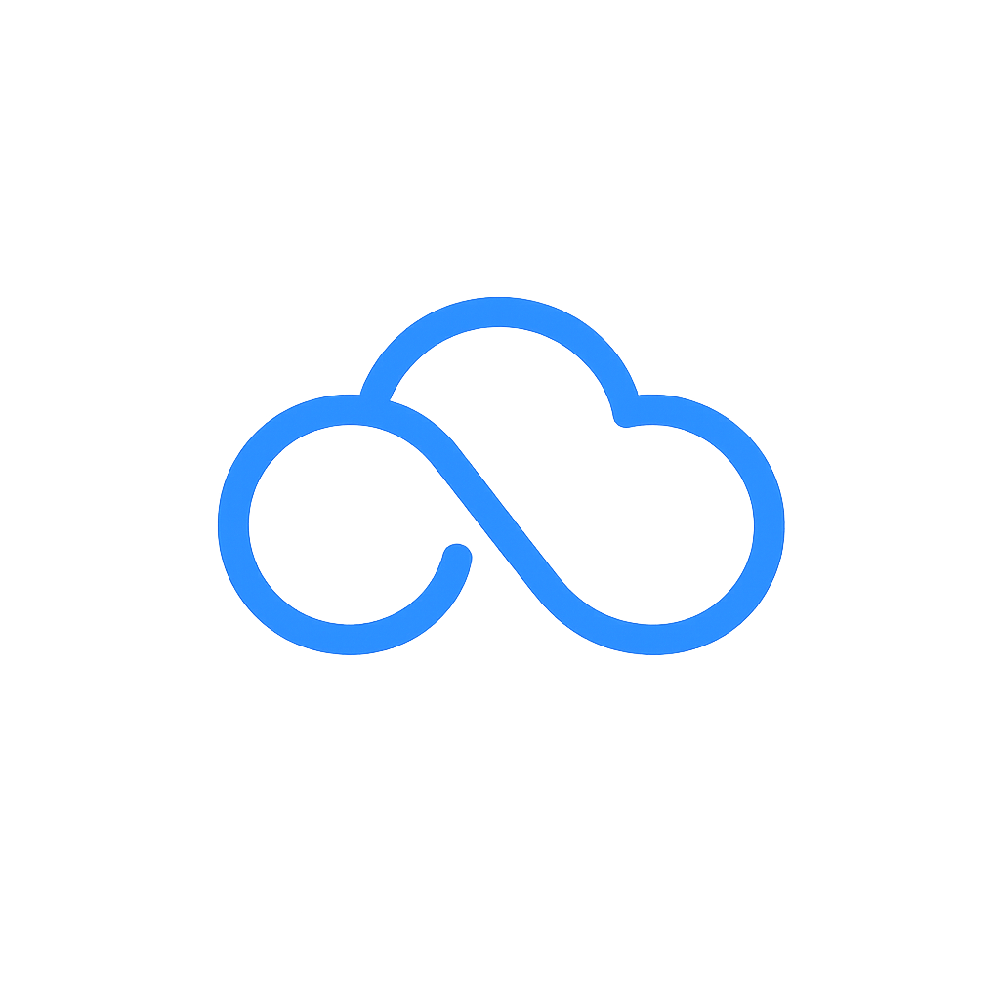
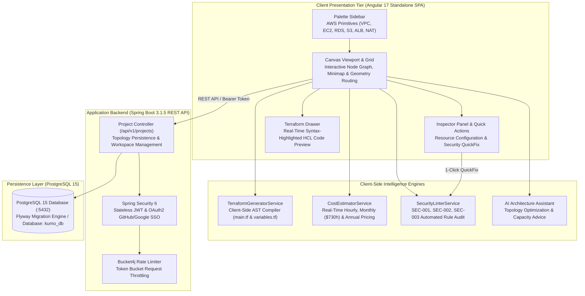

<div align="center">



# Kumo — Cloud Architecture Canvas & Terraform Compiler

**Visual Cloud Infrastructure Studio with Real-Time Cost Modeling, Security Linter, and Terraform HCL CodeGen**

<p align="center">
  <a href="#engineering-roadmap"></a>
  <a href="https://angular.dev/"></a>
  <a href="https://spring.io/projects/spring-boot"></a>
  <a href="https://adoptium.net/"></a>
  <a href="https://www.terraform.io/"></a>
  <a href="https://www.postgresql.org/"></a>
  <a href="LICENSE"></a>
</p>

<p align="center">
  Interactive cloud topology canvas with client-side Terraform HCL compilation, sub-second pricing estimation, and static security linting.<br>
  Angular 17 Standalone · Spring Boot 3 · PostgreSQL 15 · Mirotone UX Design System.
</p>

<p align="center">
  <a href="#quick-flow">Quick Flow</a> •
  <a href="#system-architecture">Architecture</a> •
  <a href="#core-capabilities">Core Capabilities</a> •
  <a href="#security-rules--quick-fix">Security Linter</a> •
  <a href="#tech-stack">Tech Stack</a> •
  <a href="#engineering-roadmap">Roadmap</a>
</p>

</div>

---

> [!NOTE]
> **Project Status: Active Development**
> Kumo is an active engineering project currently under development. This repository serves as the public architectural specification, design blueprint, and technical roadmap.

---

## Quick Flow

```
Visual Topology Canvas  →  Real-Time Cost Audit  →  Static Security Linter  →  Client-Side HCL Compiler  →  Export Terraform ZIP
```

---

## System Architecture



---

## Core Capabilities

### 01. Interactive Visual Topology Canvas & Connection Geometry
* **Containment & Hierarchy**: Native support for parent-child network topologies (VPC subnets containing EC2 and RDS instances) with automatic containment detection and bounding recalculations.
* **Orthogonal Path Routing**: Dynamic connection geometry calculates obstacle-aware routing vectors between nodes with interactive connection handles and directional data flows.
* **Spatial Navigation**: Infinite grid panning, hardware-accelerated zoom, spatial search, and minimap viewport tracking.

### 02. Client-Side Terraform HCL Compiler & Project Export
* **Zero-Latency In-Browser Compilation**: Translates the visual node-and-edge graph directly into idiomatic HashiCorp HCL (`main.tf`, `variables.tf`, `outputs.tf`) on the client side without backend round-trip latency.
* **Deterministic Resource Declarations**: Generates production-ready Terraform blocks complete with CIDR blocks, security group ingress/egress rules, subnet associations, and resource tags.
* **1-Click Project Export**: Packages generated Terraform modules into downloadable project archives ready for immediate `terraform init` and `terraform apply`.

### 03. Real-Time Cost Estimation & Pricing Heuristics
* **Continuous Cost Auditing**: Calculates instantaneous cost deltas as resources are dropped or reconfigured on canvas (EC2 instance types, RDS engines, multi-AZ toggles, S3 storage classes, NAT Gateways).
* **Transparent Budget Projections**: Provides transparent cost breakdowns at hourly, monthly (730 running hours), and annual intervals.

### 04. Automated Security Linter with 1-Click Quick Fix
* **Well-Architected Guardrails**: Continuously checks topology design against cloud security best practices and least-privilege networking.
* **One-Click Remediation**: Detects misconfigurations and provides instant "Quick Fix" actions that update the canvas topology and generated Terraform code simultaneously.

---

## Security Rules & Quick Fix

| Rule ID | Severity | Violation Condition | Automated 1-Click Quick Fix |
| :--- | :--- | :--- | :--- |
| **SEC-001** | High | S3 bucket provisioned without server-side encryption | Automatically injects `aws_s3_bucket_server_side_encryption_configuration` with AES256 |
| **SEC-002** | Critical | Security group with open ingress (`0.0.0.0/0`) on administration ports (22 SSH / 3389 RDP) | Restricts CIDR to current administrator IP or removes public ingress rule |
| **SEC-003** | Critical | Database instance (RDS) placed in public subnet or configured with public accessibility | Moves instance to private data subnet and strips public IP allocation |

---

## Tech Stack

### Frontend & Visual Engine
| Layer | Technology | Version | Purpose |
| :--- | :--- | :--- | :--- |
| **Framework** | Angular | 17.3 | Standalone component Single-Page Application |
| **Animation** | GSAP | 3.15.0 | Canvas physics, smooth transitions, and drawer reveals |
| **Icons** | Lucide Angular | 1.0.0 | Clean vector iconography across panels and catalog |
| **Language** | TypeScript | 5.4.2 | Strongly-typed domain models and AST transformations |
| **Reactive Core** | RxJS | 7.8.0 | State streams, debounced updates, and event bus |
| **Design System** | Mirotone UX | — | Glassmorphic floating panels, Google Outfit typography |

### Backend API & Infrastructure
| Layer | Technology | Version | Purpose |
| :--- | :--- | :--- | :--- |
| **Language** | Java | 17 LTS | Enterprise backend runtime |
| **Framework** | Spring Boot | 3.1.5 | RESTful microservice API |
| **Security** | Spring Security | 6.x | Stateless JWT authentication & OAuth2 SSO |
| **Rate Limiting** | Bucket4j | 8.3.0 | Token bucket rate limiting per IP / API token |
| **Database** | PostgreSQL | 15 | Primary relational datastore for project workspaces |
| **Migrations** | Flyway | 10.7.1 | Version-controlled relational database schema evolutions |
| **Containers** | Docker Compose | — | Multi-container development and staging orchestration |

---

## Engineering Roadmap

- [x] **Phase 1: Canvas Core**: Infinite grid, drag-and-drop node catalog, containment service, and connection geometry.
- [x] **Phase 2: Compiler Engine**: Client-side Terraform HCL AST generator (`TerraformGeneratorService`) and ZIP packager.
- [x] **Phase 3: Financial Intelligence**: Real-time AWS pricing estimation engine (`CostEstimatorService`) across EC2, RDS, S3, ALB, and NAT.
- [x] **Phase 4: Security Linter**: Static vulnerability scanner (`SecurityLinterService`) with 1-click Quick Fix remediation (`SEC-001`, `SEC-002`, `SEC-003`).
- [x] **Phase 5: Enterprise Backend**: Spring Boot 3.1 REST API, JWT auth, Bucket4j rate limiting, and PostgreSQL persistence.
- [ ] **Phase 6: Multi-Cloud Providers**: Extending component catalog and HCL generator to Google Cloud Platform (GCP) and Microsoft Azure.
- [ ] **Phase 7: Live State Synchronization**: Bi-directional reconciliation with live `terraform.tfstate` files and AWS CloudFormation templates.

---

## Contributing

1. Fork the repository.
2. Clone your fork:
   ```bash
   git clone https://github.com/tanmayythakare/kumo.git
   ```
3. Create your feature branch:
   ```bash
   git checkout -b feat/your-feature-name
   ```
4. Commit your changes:
   ```bash
   git commit -m "feat: add descriptive feature summary"
   ```
5. Push to your branch and submit a Pull Request.

---

## License

This project is open-source and distributed under the **[MIT License](LICENSE)**.

---

## Author

**Tanmay Thakare**
* GitHub: [@tanmayythakare](https://github.com/tanmayythakare)
* Email: [tanmayrthakare@gmail.com](mailto:tanmayrthakare@gmail.com)
* LinkedIn: [Tanmay Thakare](https://www.linkedin.com/in/tanmaythakare)

---

<div align="center">
  <a href="https://github.com/tanmayythakare">
    
  </a>
</div>
