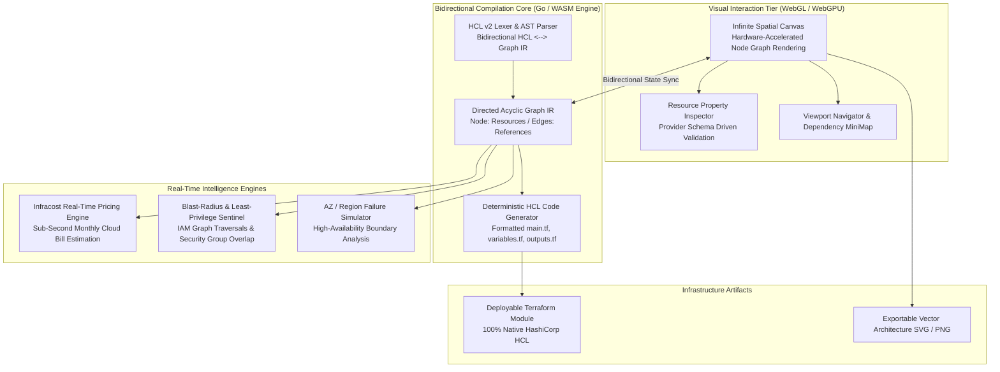

<div align="center">

# Kumo — Cloud Infrastructure Canvas & Bidirectional Terraform HCL Compiler

**Visual Cloud Architecting Engine with Real-Time HCL Generation, Cost Modeling, and Capacity Simulation**

<p align="center">
  <a href="#roadmap"></a>
  <a href="https://www.terraform.io/"></a>
  <a href="https://developer.mozilla.org/en-US/docs/Web/API/WebGL_API"></a>
  <a href="https://go.dev/"></a>
  <a href="LICENSE"></a>
</p>

<p align="center">
  Visual cloud topology designer with bidirectional Terraform HCL compilation, sub-second cost estimation, and fault-domain simulation.<br>
  WebGL canvas rendering · Bidirectional AST parser · AWS / GCP / Azure multi-cloud provider modeling.
</p>

<p align="center">
  <a href="#quick-flow">Quick Flow</a> •
  <a href="#system-architecture">Architecture</a> •
  <a href="#core-architectural-pillars">Core Pillars</a> •
  <a href="#compiler-pipeline">Compiler Pipeline</a> •
  <a href="#planned-specification">Specification</a> •
  <a href="#engineering-roadmap">Roadmap</a>
</p>

</div>

---

> [!NOTE]
> **Architecture & Engineering Blueprint**
> Kumo is under active architectural development. This repository establishes the core system specification, bidirectional HCL compilation intermediate representation (IR), and technical roadmap.

---

## Quick Flow

```
Visual Canvas Drag-and-Drop  →  Graph Topology IR  →  Bidirectional HCL CodeGen  →  Live Cost & Blast Radius Audit
```

---

## System Architecture



---

## Core Architectural Pillars

### 01. GPU-Accelerated Infinite Topology Canvas
* **High-Density Node Rendering**: Powered by WebGL/WebGPU to smoothly render hundreds of cloud resources, VPC subnets, security group linkages, and peering connections at continuous 60fps.
* **Spatial Semantic Zoom**: Transitions dynamically from high-level multi-region VPC topologies down to individual EC2, Lambda, and IAM policy attribute definitions.

### 02. Bidirectional HCL AST Parser & Compiler
* **True Two-Way Synchronization**: Edits made on the visual canvas automatically produce clean, idiomatic Terraform HCL. Conversely, pasting existing `.tf` files generates the visual topology layout instantaneously.
* **Lossless Round-Tripping**: Preserves custom comments, local variables, and variable interpolation syntax across round-trip edits without stripping developer formatting.

### 03. Sub-Second Real-Time Cost Estimation Engine
* **Instantaneous Financial Telemetry**: Queries pricing heuristics in real-time as resources and instances are provisioned on canvas (e.g. EC2 instance family switches, RDS multi-AZ deployments, NAT Gateway traffic estimates).
* **Budget Threshold Guardrails**: Highlights cost deltas dynamically before infrastructure changes are exported to Git or CI/CD pipelines.

### 04. Blast-Radius Analysis & Security Sentinel
* **IAM Least-Privilege Graph Traversals**: Automatically maps permissions, role assumptions, and public egress paths across cloud resources.
* **Fault-Domain Resilience Auditing**: Simulates single Availability Zone or Regional outages by severing nodes, demonstrating service continuity and failover readiness visually.

---

## Compiler Pipeline

```
┌─────────────────────────┐
│ Visual Topology Graph   │
│ (Nodes, Subnets, Edges) │
└────────────┬────────────┘
             │ State Dispatch
             ▼
┌─────────────────────────┐
│ Intermediate Rep (IR)   │ ◄──── Bidirectional Bridge ────► ┌─────────────────────────┐
│ (Dependency DAG)        │                                   │ Native Terraform HCL    │
└────────────┬────────────┘                                   │ (main.tf / provider.tf) │
             │ Compilation                                    └─────────────────────────┘
             ▼
┌─────────────────────────┐
│ Static Analysis Audit   │
│ • Cost Delta (Infracost)│
│ • IAM Blast Radius      │
│ • Trivy Policy Sentinel │
└────────────┬────────────┘
             │ Emit
             ▼
┌─────────────────────────┐
│ Production TF Artifacts │
└─────────────────────────┘
```

---

## Planned Specification

### Provider Support Target
* **Amazon Web Services (AWS)**: VPC, Subnet, Route Table, IGW, EC2, ECS, EKS, RDS, S3, IAM, CloudFront, Lambda.
* **Google Cloud Platform (GCP)**: VPC Network, Compute Engine, Cloud SQL, Cloud Storage, GKE, Cloud Run.
* **Microsoft Azure**: VNet, Subnets, Virtual Machines, Azure SQL, Blob Storage, AKS.

### Target Performance Benchmarks
* **AST Parse Latency**: `< 50ms` for typical configurations under 1,000 resources.
* **Canvas Frame Budget**: Fixed `16.6ms` (60fps) during active pan, zoom, and multi-node drag interactions.
* **Cost Query Cache**: Sub-10ms lookup against cached local provider pricing matrices.

---

## Engineering Roadmap

- [x] **Milestone 1**: Core system architecture, HCL bidirectional AST intermediate representation (IR) specification.
- [ ] **Milestone 2**: Standalone Go-based HCL lexer and AST round-trip serializer (`kumo-core`).
- [ ] **Milestone 3**: WebGL visual node graph canvas with reactive state synchronization.
- [ ] **Milestone 4**: AWS Provider schema generator and component palette.
- [ ] **Milestone 5**: Real-time Infracost pricing integration and visual blast-radius security overlay.
- [ ] **Milestone 6**: Local CLI compilation binary and browser-based WebAssembly (WASM) distribution.

---

## Contributing

1. Fork the repository.
2. Clone your fork:
   ```bash
   git clone https://github.com/tanmayythakare/kumo.git
   ```
3. Create your feature branch:
   ```bash
   git checkout -b feat/your-feature-name
   ```
4. Commit your changes:
   ```bash
   git commit -m "feat: add descriptive feature summary"
   ```
5. Push to your branch and submit a Pull Request.

---

## License

This project is open-source and distributed under the **[MIT License](LICENSE)**.

---

## Author

**Tanmay Thakare**
* GitHub: [@tanmayythakare](https://github.com/tanmayythakare)
* Email: [tanmayrthakare@gmail.com](mailto:tanmayrthakare@gmail.com)
* LinkedIn: [Tanmay Thakare](https://www.linkedin.com/in/tanmaythakare)

---

<div align="center">
  <a href="https://github.com/tanmayythakare">
    
  </a>
</div>
